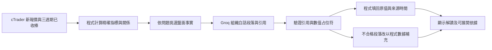

# 即時盤面對話助手：2026-10-22

## 使用方式

本機開啟 http://127.0.0.1:8765/ → 對話助手 →「即時 cTrader 盤面」，勾選「啟用 Groq 白話解讀」。可直接問「分析目前黃金盤面」「五分鐘與一小時有沒有衝突」「附近支撐壓力在哪」「十五分鐘 RSI、MACD 和波動如何」。也可由即時看盤頁的「詢問即時盤面助手」進入。

模型沒有啟用時仍能使用程式盤面解讀；模型設定、回答來源、報價與分析快照時間均明示。每次提問重新取得資料，舊答案不會隨 tick 自動改寫。歷史回放／草稿另有來源切換，保留原本規則、風險與確認功能。即時對話不建立、確認或送出交易。

若服務尚未啟動，於 product 執行既有 `start-groq.ps1`，讀取既有本機加密憑證；也可依 `.env.example` 將相同名稱的後端環境變數設入啟動程序。範例檔不會自動載入。金鑰不能放在前端、VITE_ 變數、聊天或公開 repo。

## 資料怎麼變成回答

1. 最新 Bid/Ask 必須來自已連線券商，來源時戳有時區且不超過五秒；未來或過期報價拒絕即時分析。沒有有效行情時，不借用歷史回放冒充現在。
2. 五分鐘、十五分鐘及一小時各自使用券商原生已收棒。共用既有 Decimal 技術公式，不用短五分窗口假裝還原一小時。形成中與暫存觀測棒不進指標；順序、重複、時間桶、OHLC、未知量與缺棒另檢查。末根已收棒距快照超過一個週期加三十秒時，該週期標記過期。
3. 程式提供均線位置、描述性方向、RSI14、MACD12/26/9、ATR14、來源 tick 量比，以及已確認轉折參考。同時分開算「即時 Bid 相對已收均線位置」和「上一根已收棒結構」；例如上一根收盤在均線上，但現在已在下方，不能只用舊收盤說現在仍偏多。窗口高低及變化明列最近觀測棒窗口，不能叫當日或二十四小時統計。支撐壓力只是已收棒轉折參考；量不是全球黃金成交量。
4. 依問題選週期及指標：同時問五分與一小時保留兩者；同時問 RSI 與波動保留兩種資料。未指週期先看五分與一小時。問題及最近四次使用者提問先去識別化，只供有限追問。問歷史案例時才另外執行情境檢索，只提供方向、通過群數及資料狀態，不傳真實逐筆案例。
5. **數值由程式保管，Groq 負責說明。** 寫作資料包含事實 ID、文字模板、可用占位符與已由數值計算的關係／動能判讀，不讓模型抄寫、四捨五入或重算原價。例：模型寫 `{{f5_structure}}；程式判讀{{f5_bias}}。這描述短線價格與均線的相對位置。`，程式才填回收盤、均線原值及偏多／空文字。這是依數值產生的解讀，不是讓 LLM 自行計算技術指標。
6. 每段須引用此次提供的事實 ID；未知引用、占位符、裸寫價格／百分比、中英文部分數字變體、保證宣稱及缺乏基準的部分波動措辭會被拒絕。已知引用但段落不合格時，同段改用程式事實並明標「程式補充數據」；全部段落不合格則整體退回程式摘要。模型逾時、授權或額度問題也清楚顯示原因，不假裝取得模型答案，不自動重試外部呼叫。

數值與引用檢查不是完整語意驗證器：仍不能保證所有文字推論正確，更不是預測或相似度準確率。沒有提供即時新聞、資金流與委買賣，就明說未提供。不同週期 ATR 代表不同棒長的平均真實波幅，缺少歷史比較基準時不自行定義「高波動／低波動」。

## 回覆與安全界線

回答以段落呈現，可展開「數據依據與限制」，並有相關追問按鈕。對話使用整頁高度，沒有新增右欄內部滾輪；首次載入不自動捲到輸入框，收到答案時定位到最新問答開頭。

新 API 僅接受本機 loopback／Host／Origin，關閉快取，後端才讀取 Groq 設定。前端每次請求帶明確 opt-in。寫作白名單排除帳戶、餘額、持倉、損益、token、金鑰及原始私人逐筆案例。即時助手回傳 `draft=null`，沒有委託或平倉工具。公開 Pages 本輪不接入本機私人服務，也未推送／發布。

## 驗收紀錄

真實 cTrader＋Groq 三問結果及時間留本機 `private/live_assistant_20261022/actual_groq_results.json`，未保存帳戶資料。初次載入缺棒、早期格式拒絕及快速連問觸發額度的紀錄也保留，沒有把程式降級冒稱模型成功。最終三問均 HTTP 200：兩問完整 Groq 解讀，一問由 Groq＋程式補充，約 1.36–2.08 秒／問；免費額度驗收刻意分開呼叫，這不是連續高負載保證。

測試涵蓋原生週期、過期／未來報價、舊 K 線、壞 OHLC、資料去識別、明確 opt-in、指令只讀、錯誤 JSON 型別、假價格／引用／標題宣稱、單段補正、跨週期問題、來源／快照／前端逃逸。最終指令與畫面結果見 HANDOFF 同日紀錄。
