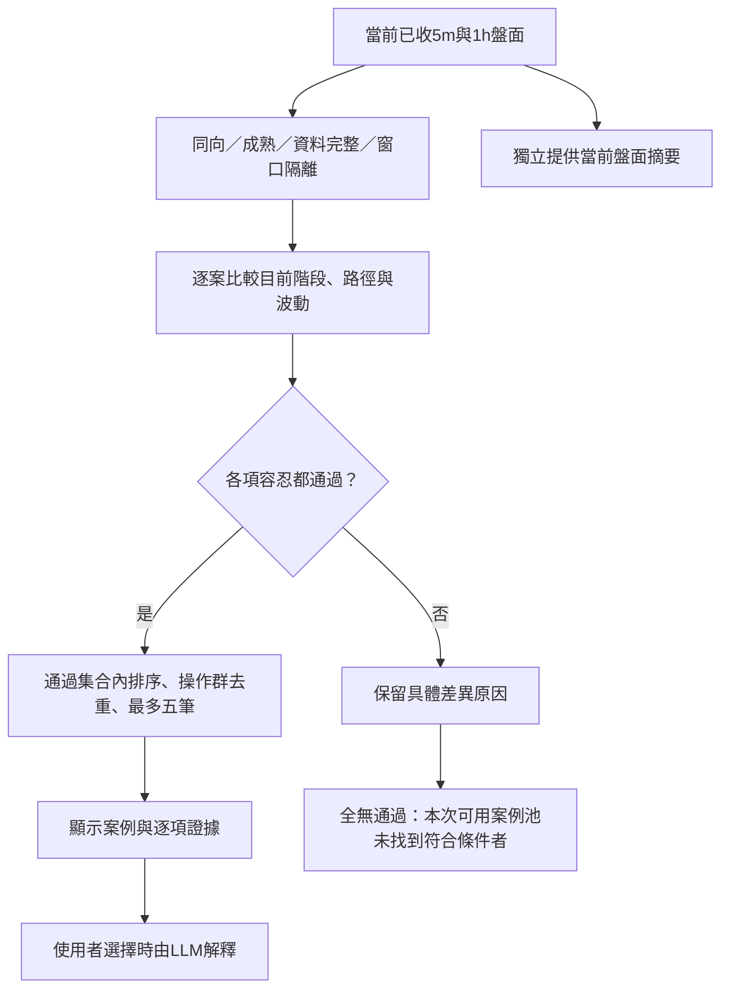

# Gold Desk：歷史盤面究竟怎樣算相似？

研究日期：2026-10-21。範圍：公開一手論文、作者程式與官方產品說明；48篇書目，10篇全文方法／實驗精讀，4個開源程式庫查核。這是研究與待驗證方案，**本輪未修改網站、排名、API或呼叫LLM，也沒有執行新的績效回測**。

## 1. 結論先講

網路上確實有「拿目前的一段走勢找歷史類比」的研究與產品。但我們真正要解的問題，應定義為：

> 在下單前，把「目前走到哪個階段、如何走到這裡、較大週期背景與波動尺度」都可比較的歷史進場案例找出來，讓使用者查看當時操作。

它比兩張圖看起來相像更嚴格，又不需要聲稱相同形狀一定會產生相同未來。**我建議採「情境可比的明確條件＋路徑檢索＋逐項證據」，先不讓LLM決定案例是否成立。** LLM可以解釋盤面、指出差異，日後以實驗檢查是否值得加入複核。

最值得修正的不是再增加十個指標，而是：**整段平均很像，能不能掩蓋此刻已經走到不同階段？**

## 2. 外面有哪些做法？證據能支持到哪裡？

| 做法／一手來源 | 如何找相似 | 對我們有用的地方 | 不能直接拿來當的證據 |
|---|---|---|---|
| [PMTS，Kim2018](https://www.mdpi.com/2071-1050/10/12/4641) | 期貨上午走勢用DTW對模板，搭配後續統計交易 | 日內形狀檢索可計算、能做滾動回測 | 黃金案例的人類相似標準或通用容忍值 |
| [Bamford等，ICAIF2023](https://arxiv.org/abs/2309.16741) | 文字／手繪對金融片段，表徵趨勢和波動 | 固定描述或草圖可當查詢介面 | 「embedding分數高＝進場情境足夠像」 |
| [Matrix Profile V，KDD2017](https://www.cs.ucr.edu/~eamonn/guided-motif-KDD17-new-format-10-pages-v005.pdf) | 在形狀最近鄰之外加入領域偏好 | 語意／用途須明定，距離不能獨力決定意義 | 套件自動知道交易者關心什麼 |
| [FinSeer，2025 preprint v3](https://arxiv.org/html/2502.05878v3) | 以教師模型的方向分類訊號訓練金融檢索 | 可以學「對特定任務有用」的相關性 | 人工覺得像、已驗證的日內黃金方法 |
| [RAFT，ICML2025](https://proceedings.mlr.press/v267/han25d.html) | 相關走勢的歷史後續加進預測器 | 檢索可與預測模型結合 | 不需訓練就能判定無相似案例 |
| [SARAF，KDD2026](https://research.birmingham.ac.uk/en/publications/stationarity-aware-retrieval-augmented-time-series-forecasting/) | 研究非平穩資料的歷史檢索與預測融合 | 相似過去可能有不同後續，必須正視脈絡 | 圖形相似就會得到相同交易結果 |

前三者較能直接幫我們定義形狀與可比性；後三者偏向預測效益。它們的分數、資料和標籤不同，不宜放在一張「準確率排行榜」。FinSeer的候選雖限制查詢之前，但資料切分是依股票，不能當成已替我們完成按時間隔離的回測。

官方產品也存在：[Chart Library](https://chartlibrary.io/)提供歷史圖形類比與後續分布；[Forecaster Pattern](https://forecaster.biz/pattern/)用歷史型態作分析。這些官方頁面證明有此類產品，**沒有提供本專題資料的獨立人工相似基準**。Chart Library的2026-03-17舊教學提到embedding與L2，但頁面本身警告產品可能已變，不能據此宣稱現行完整演算法或借用其門檻。

## 3. 先拆開三種「像」

| 名稱 | 白話問題 | 建議在專題中的位置 |
|---|---|---|
| 形狀相似 | 兩條線的升降、轉折是不是接近？ | 數值檢索依據 |
| 情境可比 | 此刻的突破／回測階段、背景、波動是否仍可互相參考？ | 主目標與人工驗證標籤 |
| 後續相近 | 後來是不是都漲／都跌，或獲利分布接近？ | 另立後續研究，不作事前相似定義 |

例如，一個歷史案例後來虧損，仍然可能是很值得參考的相似情境。相反地，兩筆都賺錢，也不代表它們的進場盤面相似。手數、盈虧、首筆或加倉繼續不參與盤面相似排序；BUY／SELL仍按使用者選擇篩案例，不變成方向預測。

## 4. 最關鍵：先約定哪些不同可以忽略

| 差異 | 建議處理 | 原因 |
|---|---|---|
| 不同年份黃金絕對價格 | 可忽略，保留百分比路徑 | 2000與3000美元可有可比的相對走勢 |
| 小幅不同報價／單根噪音 | 給有限容忍與邊界緩衝 | 不必要求券商逐價一致 |
| 轉折快慢差少數根棒 | 作「小幅受限DTW」比較組 | 可容忍速度差，但不能任意拉伸 |
| 最新已收段正在漲或正在跌 | 必須顯示，重大相反不能被舊段平均掩蓋 | 查詢發生在圖的最右端 |
| 已收回前低或仍收在前低下方 | 屬事件階段差異，嚴格可比時不互相替代 | 同V形不等於此刻相同 |
| 路徑形狀接近但波動大數倍 | 可列形狀近似，但先不列嚴格情境可比 | 對風險與價位距離的參考意義不同 |
| 1h背景有明顯差異 | 需要比較並驗證其必要性 | 不宜只靠5m小段相像 |
| 查詢後的漲跌、尚未平倉案例結果 | 排除 | 當時不可知 |

這張表是本研究提出的產品契約，**不是文獻證明的唯一正解**。應以使用者／老師對實例的判斷修訂。

標準化是選擇，不是中性操作。z-score或Pearson會消除正向幅度縮放，因此緩漲與急漲可能高度相似；現有Gold Desk「相對第一根的百分比路徑」仍保留百分比振幅，並沒有把幅度全部消掉。問題在於全窗平均與相對排名仍可能容許局部重大差異。

## 5. 用一個例子說明像與不像

以下全為**概念示例，不是實測案例**。固定參考區間下緣100、上緣110，均在事件開始前由已收資料確定，避免隨價格移動後偷換邊界。

| 查詢／歷史 | 1h背景 | 5m過程 | 現在的位置 | 判讀 |
|---|---|---|---|---|
| 查詢Q | 緩慢上行 | 從105跌至99，後收回102 | 曾跌出，現已收回區間 | 要找的情境 |
| 案例A | 近似背景 | 跌出原區間下緣後收回，幅度／速度近似 | 同樣已收回 | 可比的候選，還須通過路徑容忍 |
| 案例B | 近似背景 | 跌出後小反彈，最後仍在下緣外 | 尚未收回 | V形可能像，當前階段不同 |
| 案例C | 明顯下行 | 跌出後收回 | 與Q相同局部階段 | 局部像、背景不同，分項呈現 |
| 案例D | 近似背景 | 幾何形狀接近，但每棒典型波動約Q的3倍 | 同階段 | 形狀近似，波動脈絡不同 |

「收回」只是已收盤相對參考邊界的事實，**不等於已證明假突破或支撐有效**。前20棒極值也是可重現的參考區間，不能直接改名成必然有效的支撐壓力。

## 6. 建議的最小方法：先可比，再比有多接近

先沿用5m60根、1h20根，這是目前可測的起點，不宣稱最佳長度。保留同向、成熟、資料完整、查詢／案例窗口隔離、每操作群只留一筆等既有規則。

接著回答四個問題：

1. **目前停在哪裡？** 區間內、收在上／下緣外，或先跌出／突破再收回；必須保留最近事件過程，不能只看最後一根。末段方向接近中性或邊界時允許未知，不硬切。事件參考區間與更新規則先固定，不能看未來才挑最漂亮高低點。
2. **如何走到這裡？** 比5m路徑，另檢查最近一小段差異，避免前面很像蓋過現在不同。完整1h路徑提供背景；若實驗顯示無額外價值，可刪掉。
3. **波動尺度接近嗎？** 用已收資料的ATR／價格保留尺度差；避免「文字都是中波動」卻實際相差數倍。ATR是波動摘要，不是方向訊號。
4. **上述證據都過容忍界線嗎？** 有重大矛盾不以別軸很像抵銷。通過者才進入可比集合，集合可以為空，再從其中排最多五個。



**程式定義的示意，尚未校準或實作：**

令 `d5`、`d1h`為相對首收盤價百分比路徑的RMSE，單位是百分點；`d末段`為固定最近m根相同方式的局部路徑差；`d波動 = |log(v查詢/v案例)|`，`v=ATR14/最後收盤價`。正數、缺值及資料截止須先驗證。ATR需足夠暖機資料。

`通過 = 階段兼容 AND d5≤τ5 AND d1h≤τ1h AND d末段≤τ末段 AND d波動≤τ波動`

為便於排列，可再用各差距／其容忍值的最大者排序，最後穩定ID打破平手；所有τ必須為正。這是非補償式的選擇：最差面向不能靠其他面向抵銷。它**仍然依賴容忍值與規則**，不該稱完全無主觀權重。也可沿用目前兩軸排序，只新增接受／拒絕，作更小的改動比較。

這不是建議一次加入所有細節。實驗先用現有雙路徑作基線，逐項加末段、波動、事件過程，只有保留測試證明有價值的才留下。m、區間長度與τ目前沒有數據支持，這輪不填一組看似精確的標準數字。

## 7. 文字檢索能不能直接取代這些計算？

可以用固定描述作介面、索引條件與說明，但不建議把全部判定交給文字embedding或LLM。

```text
方向：BUY（使用者指定）
資料截止：最後已收棒；5m 60根／1h 20根
5m過程：下行後反彈；最近事件為跌出既定下緣後收回
目前階段：區間內、已收回下緣；邊界定義與事件起點另存
末段：小幅回升；原值與觀察根數另存
1h背景：緩升後整理；完整路徑另存
波動：ATR14／價格及其計算版本另存
來源：券商已收報價／歷史PROJECT_REFERENCE分別標示
```

描述由程式模板生成，數值及單位另有結構欄位。這樣每一句都查得到依據，不會因LLM改寫成「強勢突破」而改變檢索結果。`下跌→反彈→盤整`可以讓人理解，但只有三個詞無法區分B與A，正是之前看起來都像又不太一樣的原因之一。

若老師希望只有一套方法，可以稱為**「結構化盤面案例檢索」**：文字是同一份特徵的說明，不必說成第二套語意系統，也不必另加RAG才能比較數字。RAG負責把已找出的證據交給助手回答，不能自動定義哪些數字算近。

## 8. 另一個值得跳脫的框架：分開兩個資料庫

| 資料庫 | 收錄內容 | 能回答 |
|---|---|---|
| 市場類比庫 | 每個合格歷史收盤時點的盤面，不要求有交易 | 市場以前有沒有出現過可比狀態？ |
| 交易員操作庫 | 確實存在的歷史交易與其進場前盤面 | 交易員在可比盤面做過什麼？ |

我們現在主要是第二個。它是下單時點選出的樣本，有自然的選擇偏誤。沒有交易員案例，不等於市場從未發生相似走勢；不能把一般行情窗口捏造成交易員進場。

若日後做第一個，MASS／Matrix Profile有成熟實作；已有當前query可直接掃歷史距離，不必每次做全部兩兩比較。[STUMPY官方教學](https://stumpy.readthedocs.io/en/latest/Tutorial_Pattern_Matching.html)。但它只算形狀距離，仍需本案的截止、缺口、事件與尺度判定。既有萬筆案例庫未證明有效能瓶頸，現在不必為此增加向量資料庫。

## 9. 怎麼才可以說「這次沒有相似案例」？

至少分三種回應：

- **盤面資料不足**：不能比較；不是不相似。
- **沒有合格歷史操作案例**：方向／成熟／資料條件沒有通過者。
- **有可比較案例，但本次可用案例池沒有通過相似條件者**：可以展示差異原因，不能硬塞前五。

最近鄰永遠能有第一名；相對百分位也總能產生靠前的人。甚至STUMPY `match`的預設距離界線也至少返回最近一筆，**其預設不是我們需要的拒絕校準**，已核對固定SHA源碼，見第四階段。

「全庫無任何相似」還涉及搜尋是否完整：若只看前五再讓LLM全拒絕，只能說前五未通過，除非能保證其他案例也不可能通過。明確距離界線可在完整合格池驗證；LLM有限候選複核無此保證。

## 10. 如何用最少實驗回答老師的質疑？

先做一個小型可重跑驗證，不先訓練模型：

| 步驟 | 具體作法 | 要回答 |
|---|---|---|
| 凍結目標 | 寫一頁可比rubric，先舉可忽略變動與重大矛盾 | 我們到底把哪種像當成果？ |
| 先導日期 | 已看過十天只作開發，列出波動／末段／階段錯配 | 現在方法哪裡不足？ |
| 新資料 | 預先選30個新不同日期、不重疊查詢；兼顧盤整、突破及波動，不事後挑漂亮圖 | 避免只差一根棒或好看的例子 |
| 方法對照 | A現有雙路徑；B加末段；C再加波動；D再加事件階段。另視資源試小幅DTW、純固定文字 | 各項增加是否值得？ |
| 標註 | 兩人獨立看同尺度5m／1h圖及數值，遮方法／距離／來源身份／後續盈虧；可比／不可比／不足＋理由 | 人工標準與一致性 |
| 隔離 | 按日期與操作群／重疊窗口切開，開發及校準只用較早部分，保留較晚部分 | 規則沒有偷看答案？ |
| 界線 | 在校準部分選保留率與誤收的折衷，之後凍結 | 容忍不是拿測試結果手調？ |
| 報表 | 可比精確率、覆蓋、每查詢是否有通過、拒絕原因、人工分歧與區間 | 有多像，代價是少回多少？ |

30個查詢是小型可行性起點，不是統計充分的正式樣本數。每次最多五筆只是呈現窗口，不是完整真值；比較各法前五的聯集、補一些接近界線的難例與匹配背景的對照，抽樣規則先固定。若只標一法前五，無法公平評其他方法或推算整池召回率。

拒絕後可比精確率提高但全部都拒絕也沒有用，故必須同報覆蓋。未完整標全庫時，**誤拒與召回只能針對已標註集合**，不宣稱知道全庫漏了多少。以查詢日期為主要抽樣單位，不把同一查詢的五配對當五個獨立市場情境；日期太少時只報探索性區間。

另做不需要人工真值的健全性檢查：改絕對價位、小噪音應較穩定；把最後幾根翻成相反方向或把振幅放大三倍，應能反映相應差異。這些是合成控制，不是證明市場準確率。

如果兩位標註者經常不同意，先修定義，不是叫第三個LLM投票讓數字好看。如果H1或某限制在保留期間沒有額外價值，就刪掉，而非一定維持複雜方法。

## 11. LLM與統計保證放在哪裡？

LLM可協助整理「兩者都跌出後收回，但歷史波動較大」等逐項差異；程式提供可追溯數字。若以後試LLM複核，作獨立比較組，測誤收／誤拒、輸入順序與重複輸出的穩定性、成本延遲，保留無法判斷。不能以模型自己的信心作準確率。

也不宜現在套Conformal名稱說有90%相似保證。[Conformal Risk Control](https://arxiv.org/html/2208.02814v4)需要可交換抽樣、特定單調有界損失等前提，保證是邊際期望；接受集合中的錯誤比例不自然滿足單調，時間序列又有依賴與漂移。可以先作經驗校準與時間隔離評估，清楚交代界線適用的資料與期間。

## 12. 我們現有結果究竟暴露什麼？

回讀本機 `distinct_day_dual_path_20261021/summary.json`：十個不同日期第一名均不同、同末棒高低狀態10/10，但平均波動倍率約**2.16倍**；5m／1h平均路徑差約0.160／0.323百分點。這不是相似準確率。

這支持要測「全窗平均掩蓋末段、同粗類別不代表同過程、波動尚無接受界線」這些假說，尚不能證明加入新限制一定更好。原始時鐘仍未獨立核實，但可以繼續依專題參考盤面做可比研究；本輪不以完美時鐘當成停止成果的前提，也不把參考定位改稱完全還原真實交易。

## 13. 建議採用的報告說法

> 本系統以「決策前盤面情境可比」為案例相關性目標。它比較當前事件階段、短週期走勢、較大週期背景與波動尺度，將可接受差異明示並以獨立日期的人工判讀校準。系統允許沒有通過案例，提供逐項依據及當前盤面摘要；案例的後續損益不參與相似判定。

下一步最有價值的是**凍結這個可比契約，做少量新日期的成對盲評與逐項消融**。不必先換整套架構，也不必因沒有通用門檻而做不出成果。

## 研究附件

- [48篇書目與範圍](../phase2_survey/survey.md)
- [10篇全文筆記](../phase3_deep_dive/deep_dive.md)
- [4個開源實作與版本](../phase4_code/code_repos.md)
- [跨文獻綜合](../phase5_synthesis/synthesis.md)／[尚待驗證缺口](../phase5_synthesis/gaps.md)
- [參考書目BibTeX](references.bib)

搜尋限制：以英文公開可取得的一手資料為主，書目廣搜不等於系統性涵蓋所有金融研究；文獻主體與工具已閱讀核對，但未重現作者實驗。部分近期文獻是preprint／workshop，已與正式會議區分；不以產品宣傳或其他任務分數推算本專題表現。
